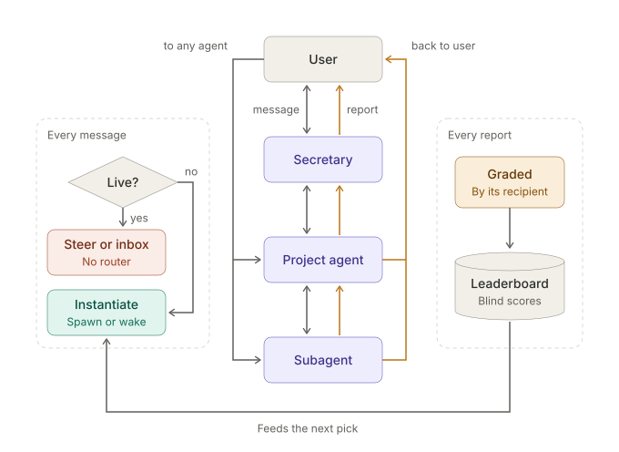

# Arity wiki

Source of truth for the Arity architecture. Last updated 2026-11-18.

Arity is a multi-agent system. A user works with a small hierarchy of agents; a central router decides which model runs each agent without telling anyone which one it picked; and every finished piece of work is graded so the router's future picks improve.



## How to read the baseline

- **The column** is the chain of command: user, secretary, project agent, subagent.
- **Between neighbours**, messages go both ways (grey) and reports go up only (amber).
- **The rails** are the user's direct line: the left rail messages any agent, the right rail carries that agent's report straight back.
- **Every message** (left box) is delivered according to the recipient's state. A live agent gets it by steer or inbox. A cold or not-yet-created agent is instantiated first, which is [its own diagram](instantiate.md).
- **Every report** (right box) is graded by whoever receives it. Grades fill the leaderboard, which instantiation reads when it picks the next model.

## Pages

| Page | Covers |
|---|---|
| [Agents](agent-tiers.md) | The three tiers, messages, reports, delivery, agent states |
| [Instantiate](instantiate.md) | The spawn or wake step: resolve role, pick variant, load context, get computer, grant access, assemble |
| [Database](database.md) | The graph of people, projects, tasks, agent runs and models |
| [Computers](computers.md) | The computer pool and agent workspaces |
| [Access](access.md) | Passwords and credentials: the vault, grants, the access broker |
| [Blind testing](blind-testing.md) | Variants, trial records, the grading hook |
| [Papercuts](papercuts.md) | Quick complaints and help requests, and how they become tested fixes |
| [Model router](model-router.md) | Blind model selection, leaderboard, endpoint pool |
| [Capabilities](capabilities.md) | Skills, MCP servers, tools, roles |
| [Open questions](open-questions.md) | Decisions not yet made |
| [Roadmap](roadmap.md) | Features in the order they are being designed |

## Status

Roadmap items 1 to 9 are designed, items 8 and 9 only as proposals. The baseline covers who talks to whom; [Instantiate](instantiate.md) covers how an agent is built. Item 10 (slot-in third-party pieces) is next.

A second pass is planned once more of the roadmap is designed, mainly to settle how prompts, skills, tools and MCP servers differ between the three tiers.

## Diagrams

Diagrams are generated by [diagrams/build.py](diagrams/build.py). To change one, edit its function and run:

```bash
python3 .wiki/diagrams/build.py
```

The baseline stays about who talks to whom. Anything that happens when an agent is built goes in the instantiate diagram, not the baseline.

Conventions: purple is an agent, teal is instantiation and model routing, coral is delivery and loadout, amber is reports and grading. A diamond is a decision and a cylinder is a store. Each kind of call is defined once, not repeated on every arrow.
