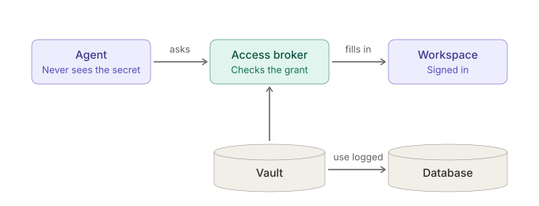

# Access

[Back to index](README.md)

Agents that operate computers need to sign in to things. This page covers how they use passwords and other credentials without those secrets ever passing through a model.

## The rule: the model never sees the secret

An agent does not receive a password. It asks an **access broker** to sign in somewhere. The broker checks the agent is allowed, takes the secret from the **vault**, and fills it in directly on the agent's workspace.

Two reasons this matters more here than in most systems:

- **Model choice is blind and spread across providers.** Anything in an agent's context is sent to whichever provider the router picked, which nobody in the conversation knows. A password in context would go to an unknown third party.
- **Whatever a model sees can come back out**, in a report, a papercut, a log, or a message to another agent.

## Grants

A grant is permission to use one credential. The "Grant access" step of [Instantiate](instantiate.md) hands them out.

| Property | Meaning |
|---|---|
| Scoped | Only the credentials this task needs, decided by the role and the task's clearance |
| Temporary | Valid while the agent is live, and kept for a short while after it goes cold so that waking is quick |
| Logged | Every use is recorded against the agent run in the [database](database.md). The secret itself is never recorded |

## What the vault holds

- Passwords for sites and apps.
- API tokens and keys for services, including a key for procuring cloud machines and GPUs.
- Signed-in sessions. Agents can use sessions the user is already signed in to; the secretary adding to the user's calendar is the plain example.
- SSH keys.

Anything that needs the user's own device, such as a one-time code or a passkey, blocks the task on the user as a "user's eyes" gate.

## Clearance

Clearance is a field on every [task](database.md#tasks). It limits three things: which credentials are granted, which machines the task can run on, and which models can be picked.

- **For models it is the task's choice:** smart, fast, free or private. Private keeps a task on local models, so a task that touches banking leaves nothing on other machines; tasks a private run files are private too.
- **It covers people as well as models,** which is what allows sharing Arity with others. Sharing itself is [set aside for now](open-questions.md#sharing-with-other-people).
- **The router applies it first,** before weighing quality or cost.

A model's own reluctance also counts. Some models are uncomfortable with some tasks, and routing sends those tasks elsewhere. How that is recorded is [still to be worked out](open-questions.md#model-reluctance).

## What the screen shows

Keeping the password out of the model's context is not enough for computer use. Once signed in, the screen can show private information, and an agent operating a computer sees the screen. Clearance decides which models may look, and further protection for what is on screen is [still to be designed](open-questions.md#screen-protection).

## Approval

Some actions wait for a person even when the agent holds a grant: paying, sending, deleting, changing account settings. This is the "user's eyes" gate applied to a single action. The list starts from what is intuitive and is adjusted if it proves too loose or too tight. It is [still to be written](open-questions.md#approval-for-actions).

## Asking for more

An agent that lacks access files a [papercut](papercuts.md) as a request for help. That reaches the parent or the user as a normal message, and either can widen the grant.

## What to build

The access broker is specific to Arity and is built: the grants, the scoping, the logging and the filling-in. It never holds a secret for longer than the moment of use.

Whether the vault itself is built or is an existing tool is [undecided](open-questions.md#vault).
