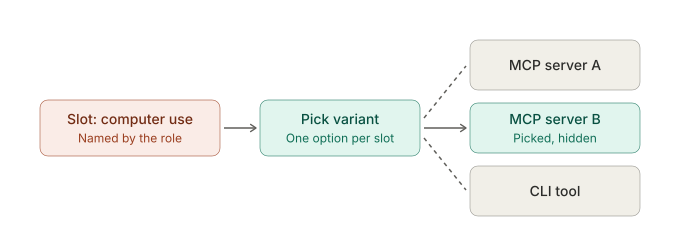

# Blind testing

[Back to index](README.md)

Every agent run doubles as a test. The system tries different models, harnesses, skills, MCP servers and personas without telling anyone which is in use, and learns from how each run is graded.

## What is tested

A **variant** is one choice for each of five things:

| Dimension | What it is |
|---|---|
| Model | Which model runs the agent |
| Harness | The program wrapped around the model: its loop, context handling and tool calling. Swappable per agent. The starting set is Claude Code, Codex and agy for their own models, plus pi |
| Skills | Which version of a skill, or which set of skills |
| MCP servers | Which servers, or which version of one |
| Persona | Which version of the role's system prompt |

The role sets the defaults. A trial changes something from those defaults.

## The loop

1. **Pick variant.** In [Instantiate](instantiate.md), the model router picks a variant. Nobody outside the router is told what it picked.
2. **Seal it.** The router writes a trial record linking this agent run to its variant. In the [database](database.md) it is the sealed link between an agent run and a model.
3. **Agent runs.** It does its work and reports as usual.
4. **Grade.** The recipient rates the work, and metrics and gate results are collected automatically.
5. **Score.** The grade is joined to the trial record and averaged into the variant's score.
6. **Next pick.** Scores inform the router's next choice.

The same task is not run twice. Each task gets one variant, and comparisons build up across many tasks.

## Slots

A role can name a **slot**: something the agent needs that several interchangeable options can provide. A computer use task, for example, could be served by any of several MCP servers or command-line tools.

The router picks one option per slot. A run can differ from the role's defaults in several places at once. Because many things are always being trialled, the data ends up spread across combinations, and each option's score is its average over all the runs it appeared in. The trial record lists everything that differed, so a good model is not blamed for a bad tool.

## Grading

**The rating is one question:** "How did this ___ do?", answered with a number from 1 to 5 and a paragraph. Whoever asked for the work rates whoever did it. The form can change over time and differ by task.

**When.** On any exchange, a single reply or a final report. Not necessarily every turn; how often is [not fixed](open-questions.md#rating-frequency). A long-running agent collects many ratings; a short subagent may collect one.

**The grading hook.** An agent that creates a subagent is hooked to rate what comes back. Whether it must do so before carrying on is [undecided](open-questions.md#blocking-ratings).

**Who rates the secretary and project agents.** The user, and the secretary for project agents.

**The user** is never required to rate. Their edits and overrides count as signals.

**Gates and metrics.** Much of grading is deterministic and needs no rater: a task's gates (tests, CI, a QA bot), end-to-end time, tokens and cost, failed tool calls, steers needed. See [Model router](model-router.md#scores).

**The other direction.** The diagram also shows the doer rating the asker: a subagent rating the parent that briefed it, or an agent rating the user. This is [planned for later](open-questions.md#agents-rating-users), not the first version. One likely form is an exit report: when an agent's cache is about to go cold, it writes a short account of how the work went, which would also catch papercuts it never filed.

## Keeping it honest

- **The grader does not see the variant while grading.** It is revealed afterwards, and a reveal option is available at any time.
- **The grader's own variant is recorded with the grade.** Models tend to favour output from their own family.
- **Scores are kept per role, tier and kind of task.**

## Limits on experimenting

- **How much to explore follows supply.** More when tokens are plentiful or a quota is about to reset, less when they are scarce. Local models count only while a GPU is free.
- **Sensitive and important work is spared.** A task's clearance and priority decide whether it can be used for a trial.
- **A minimum number of runs** before a variant's score affects picks.
