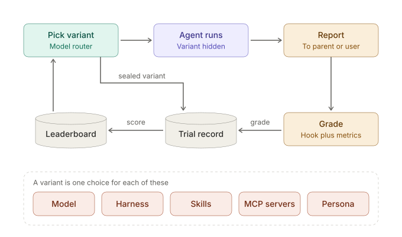
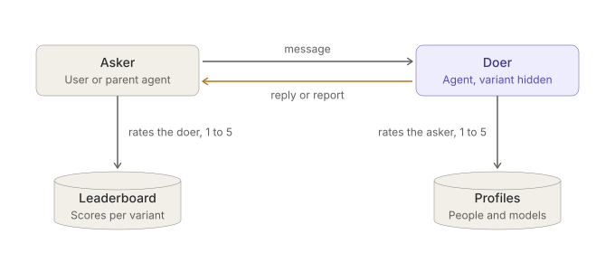

# Blind testing

[Back to index](README.md)

Every agent run doubles as a test. The system tries different models, harnesses, skills, MCP servers and personas, without telling anyone which is in use, and learns from how each run is graded.

## What is tested

A **variant** is one choice for each of five things:

| Dimension | What it is |
|---|---|
| Model | Which model runs the agent |
| Harness | The program wrapped around the model: its loop, context handling and tool calling |
| Skills | Which version of a skill, or which set of skills |
| MCP servers | Which servers, or which version of one |
| Persona | Which version of the role's system prompt |

The role sets the defaults. A trial changes something from those defaults.

## The loop

1. **Pick variant.** In [Instantiate](instantiate.md), the model router picks a variant. Nobody outside the router is told what it picked.
2. **Seal it.** The router writes a trial record: this agent instance ran this variant. The record is the only place the two are linked. In the [database](database.md) it is the sealed link between an agent run and a model.
3. **Agent runs.** It does its work and reports as usual.
4. **Grade.** The report's recipient grades it, and metrics are collected automatically.
5. **Score.** The grade is joined to the trial record, which reveals the variant to the leaderboard and to nobody else.
6. **Next pick.** The leaderboard informs the router's next choice.

This is not a classic A/B test. The same task is not run twice. Each task gets one variant, and comparisons build up across many tasks.

## Grading

Grading is a rating, and it can happen on any turn, not only when an agent finishes.

**The basic rating is a number from 1 to 5.** Whoever asked rates whoever answered. It can be as simple as "rate the agent on a scale of 1 to 5". A short reason is optional.

**When it happens.** On any exchange: a single reply, or a final report. A long-running agent collects many ratings over its life; a short subagent may collect one.

**Ratings go both ways.** The doer also rates the asker. A subagent rates the parent that briefed it, and an agent rates the user it worked for, and can write a short report about them. These go to the person and model pages in the [database](database.md), not to the variant leaderboard, though a child's rating of its parent is also evidence about the parent's variant.

**The grading hook.** When an agent creates a subagent, it is hooked to rate what comes back. Whether that rating must happen before the parent carries on is not decided; see the trade-off below.

**Automatic metrics.** Collected without asking anyone: end-to-end time, tokens and cost, failed tool calls, steers needed, whether the task was re-spawned, and whether verifiable checks (tests, build) passed.

**The user** is never required to rate. Their edits and overrides count as signals.

See [Model router](model-router.md#leaderboard) for the full list of signals.

### Blocking or not: the trade-off

| | Must rate before continuing | Can rate later, or not at all |
|---|---|---|
| Coverage | Every exchange gets a rating | Gaps, and the gaps are biased: strong opinions get recorded, average ones do not |
| Quality of the rating | A first impression, before the result has been used | Informed by whether the result actually worked |
| Cost | A little time and tokens on every exchange | Nothing unless a rating is given |
| Risk | Graders learn to answer by rote | The grader may be cold or finished by the time the outcome is known |

A possible middle: a required quick 1 to 5 at the moment of receipt, which is cheap, plus the option to revise it later when the outcome is known. Not decided.

## What varies in a trial

A role can name a **slot**: something the agent needs that several interchangeable options can provide. A computer use task, for example, could be served by any of several MCP servers or command-line tools.

The router picks one option per slot. With many slots there is a lot to trial, so a run may differ from the defaults in more than one place. Whether to limit that is not decided:

- **One change per run** makes it obvious what caused a score, but learns slowly when there are many slots.
- **Several changes per run** learns faster. Each option's score is then its average across all the runs it appeared in, which works when there are enough runs and misleads when there are few.

## Keeping it honest

- **The grader never sees the variant.** That is the point of blind.
- **Record who graded.** The grading agent is itself a hidden variant. Models tend to favour output from their own family, so the grader's variant is stored with the grade.
- **Know what changed.** The trial record lists every way the run differed from the role's defaults, so a good model paired with a bad tool is not blamed for the tool.
- **Score per role, tier and task type.** No single global ranking.
- **Record why a variant was picked:** best known, cheapest, or exploration.

## Limits on experimenting

- **An exploration budget.** Only a set share of runs try an unproven variant.
- **Not on everything.** High-priority or high-clearance tasks should use the best known variant. The task's priority and clearance fields in the [database](database.md) decide this.
- **A minimum sample** before a variant's score affects picks.

## Not settled

See [Open questions](open-questions.md#blind-testing).
