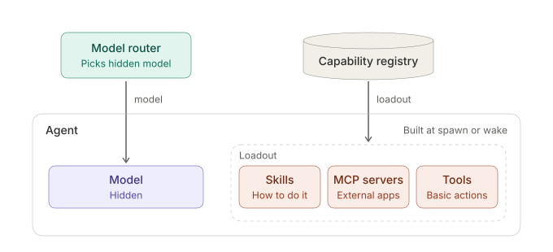

# Capabilities

[Back to index](README.md)

An agent is a hidden model wrapped with a system prompt and a loadout. The model is chosen by the model router; the prompt and loadout are attached in the last step of [Instantiate](instantiate.md).

## The three kinds of capability

| Kind | What it is | Example |
|---|---|---|
| Tools | A single built-in action | Read a file, run a command |
| MCP servers | A connection to an outside system, bringing its own set of tools | Calendar, code host, browser |
| Skills | Packaged instructions for a kind of task, loaded only when relevant | "How to review a pull request" |

All three are listed in the **registry**. Whether the registry becomes part of the database is [undecided](open-questions.md#registry-in-the-database).

## Roles

A role is a named bundle in the registry.

A role contains a **system prompt**, which says who the agent is and how it should work, and a standing kit of **skills**, **MCP servers** and **tools**.

Roles can specialise. "Python developer" and "iOS developer" inherit everything from "software engineer" and add their own parts. Other starting roles: writer, namer, designer.

Role and tier are independent. Tier (secretary, project agent, subagent) is where an agent sits and how long it lives. Role is what it is good at. A subagent can be an iOS developer, and so can a project agent.

## Where a loadout comes from

Two sources, combined at instantiation.

| Source | Supplies | Example |
|---|---|---|
| The role | The standing kit: what this kind of agent always has | An iOS developer's prompt and usual skills |
| The task entry | What this piece of work needs on top | Its requirements field: Xcode, computer use |

The task entry names the role. The role supplies the basics so that task entries do not have to restate them, and the task's requirements add to and choose within that kit. Whether the router returns the assembled loadout or only the model is [undecided](open-questions.md#what-the-router-returns).

A requirement can often be met by several interchangeable options. Which one an agent gets is chosen blind; see [slots](blind-testing.md#slots).

A child's loadout does not have to be a subset of its parent's. A subagent can be given tools its parent lacks.

## Adding to the registry

The user or the secretary adds things. The usual path: the user comes across something, such as a post or a repository, and hands it to the secretary.

- If it does the same job as tools already listed, it goes in beside them as another option for that slot.
- If it is a new kind of thing, the secretary passes it to a suitable agent for a closer look, or raises it with the user.

Smaller loadouts are cheaper, because every MCP server's tool descriptions take room in the model's context, and safer.
