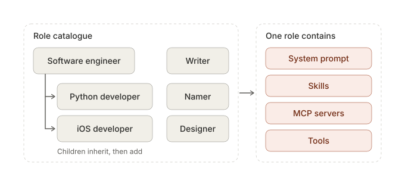

# Capabilities

[Back to index](README.md)

An agent is a hidden model wrapped with a system prompt and a loadout. The model is chosen by the model router; the prompt and loadout are attached afterwards, in the "Assemble agent" step of [Instantiate](instantiate.md).

## The three kinds of capability

| Kind | What it is | Example |
|---|---|---|
| Tools | A single built-in action | Read a file, run a command |
| MCP servers | A connection to an outside system, bringing its own set of tools | Calendar, code host, browser |
| Skills | Packaged instructions for a kind of task, loaded only when relevant | "How to review a pull request" |

All three live in one shared **capability registry**, the same way every model comes from one endpoint pool. In the [instantiate diagram](instantiate.md) it is the "Registry" cylinder under "Resolve role".

## Roles

A role is a named bundle from the registry. A parent asks for a role by name instead of listing capabilities.

A role contains:

- **System prompt**: who the agent is and how it should work.
- **Skills**, **MCP servers** and **tools**: its loadout.

Roles can specialise. "Python developer" and "iOS developer" inherit everything from "software engineer" and add their own parts. Other starting roles: writer, namer, designer.

Role and tier are independent. Tier (secretary, project agent, subagent) is where an agent sits and how long it lives. Role is what it is good at. A subagent can be an iOS developer; so can a project agent.

## How a request uses them

See [Instantiate](instantiate.md): the request names a role, the registry resolves it, the model router picks a model, and the prompt and loadout are attached to that model.

## Design notes

- **Smaller loadouts are cheaper.** Every MCP server's tool descriptions take room in the model's context.
- **Smaller loadouts are safer.** This matters once passwords and computer use arrive (roadmap items 8 and 9).
- **Grades attach to the model and the role together.** This is the groundwork for blind testing of skills, MCPs and personas (roadmap item 5).
