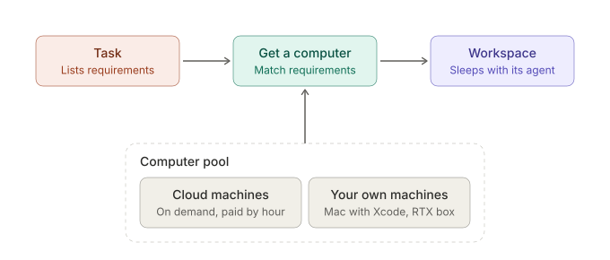

# Computers

[Back to index](README.md)

Some tasks need a machine to work on: one with Xcode, one with a GPU, or one with a screen an agent can operate. The computer pool is where those machines come from.

## The computer pool

| Kind | Cost | Limit |
|---|---|---|
| The user's own machines | Free | Only what they have, and only when it is on |
| Cloud machines | Paid by the hour while running | A spending limit set by the user |

Each machine lists what it offers, using the same fixed list a task uses for its requirements: Xcode, an NVIDIA RTX card, computer use.

## How a task gets a computer

1. A task's **requirements** field says what it needs. See [Database](database.md#tasks).
2. At [instantiation](instantiate.md), the "Get computer" step matches those requirements against the pool, preferring a free machine of the user's, then the cheapest cloud machine that qualifies.
3. If nothing in the pool matches, a cloud machine is obtained. The [vault](access.md) holds a key for procuring machines and GPUs.
4. The agent is given a **workspace** on the machine.

A task with no requirements gets no computer.

A subagent generally works on its project's computer. That can differ by task.

## Two machines, ideally

The agent runs on one cloud computer and carries out its commands on another. A mistake or a bad instruction then cannot reach the machine the agent itself lives on.

## Workspaces follow the agent's life

| Agent state | Workspace |
|---|---|
| Live | Running |
| Cold | Asleep: stopped, with its disk kept |
| Woken | Resumed where it left off |
| Finished | Released |

This matters most for project agents, which live for weeks and should not pay for a running machine while idle. Workspaces and worktrees that are no longer needed are cleaned up.

## Related rules

- **Clearance applies to machines.** A task's clearance limits which machines it can land on.
- **The machine is part of the variant.** Where an agent ran can affect how well it did, so it is on the trial record.
