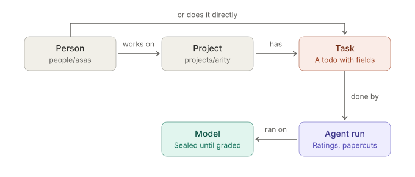

# Database

[Back to index](README.md)

The database is the system's record of what needs doing, who did what, and how it went. It is a graph: every person, project, task, agent run and model is a page, and pages link to each other. It reads like a wiki.

## Pages and links

| Page | Example path | Links to |
|---|---|---|
| Person | `people/asas` | The projects they work on, the tasks they did, ratings about them |
| Project | `projects/arity` | Its tasks, its people, its project agent |
| Task | `projects/arity/tasks/...` | The tasks it blocks and is blocked by, who did it |
| Agent run | under its task | Its ratings, its papercuts, the model it ran on |
| Model | `models/...` | Every run it did, its scores |

**Progressive disclosure.** A page shows a summary and links, and detail is one step further in. `people/asas` lists projects; a project lists its tasks; a task shows who did it, whether that was the person or an agent; an agent run shows what happened.

## Tasks

A task is a todo with fields. These are the candidate fields and what each one is for.

| Field | Meaning | Used by |
|---|---|---|
| Clearance | Who is allowed to see or do the task | Instantiation, to limit which agents and credentials it can use; blind testing, to keep experiments off sensitive work |
| Priority | How important it is | Ordering; high priority work gets the best known variant |
| Blocks and blockers | Which tasks must finish first | Deciding which tasks are ready |
| Requirements | What the task needs to run: Xcode, an NVIDIA RTX card, computer use | Matching the task to a machine (see [Computers](computers.md)) and to a role's slots |
| Gates | What must pass before it counts as done: tests, CI, a QA bot, the user's eyes | Grading. A gate result is a verifiable check, stronger than a rating |
| Tags | Free labels | Search and grouping |
| Due date | When it is needed, if at all | Ordering |

### Task states

1. **Open.** Created by the user, the secretary or a project agent.
2. **Ready.** No open blockers.
3. **Assigned.** A person took it, or an agent was instantiated for it.
4. **In gates.** The work is reported; its gates are being checked.
5. **Done.** All gates passed.

## What moves into the database

Several stores designed earlier are parts of this one graph.

| Earlier name | What it is in the database |
|---|---|
| Leaderboard | Scores on model pages, added up from ratings on agent runs |
| Trial record | The "ran on" link between an agent run and a model, sealed until the run is graded |
| Profiles | Person and model pages |
| Papercut log | Papercuts attached to agent runs and tasks |

The baseline diagram still says "Leaderboard", because that is the part of the database it reads.

Two stores stay separate, because they describe what is available, not what happened: the **registry** (roles, skills, MCP servers, tools) and the **endpoint pool** (ways to reach a model).

## How instantiation uses it

A message that spawns or wakes an agent names a role and a task. [Instantiate](instantiate.md) reads the database twice:

- **Pick variant** reads scores.
- **Load context** reads the task page, its project, and the relevant profiles, so the agent starts knowing what it is doing and for whom.

## Blindness

`people/asas` can show that a task was done by an agent, and eventually which model. That link is the trial record, so it stays sealed until the run has been graded. Otherwise browsing the wiki would reveal the variant to the grader.

## Not settled

See [Open questions](open-questions.md#database).
