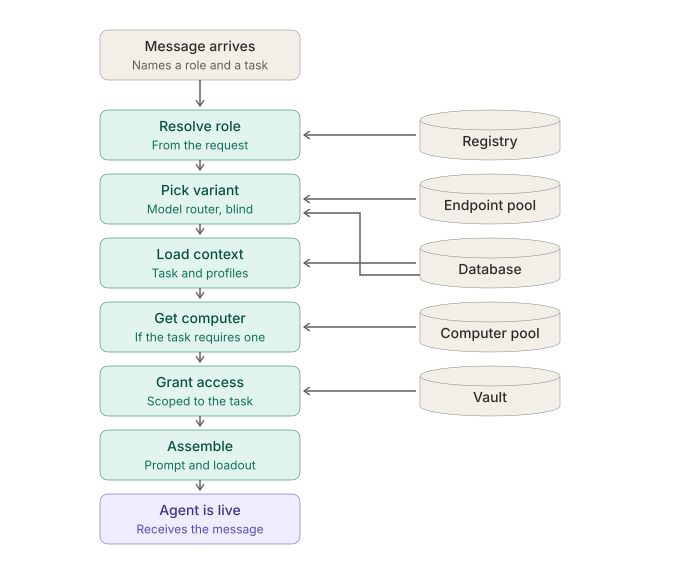

# Instantiate

[Back to index](README.md)

Instantiation builds an agent. It runs when work arrives for an agent that is cold or not yet created, which is the "no" branch of the "Live?" decision in the [baseline](README.md). A live agent never goes through it.

Creating a new agent and waking a cold one are the same six steps. A new agent starts fresh or as a fork of its parent; see [How work starts](work.md#fresh-or-fork).

The trigger is usually a task entry on the board, which says what kind of agent is wanted, what it requires and its clearance.

## Steps

| Step | What it does | Reads from | Details |
|---|---|---|---|
| 1. Resolve role | Looks up the role the task asks for and gets its system prompt and standing kit | Registry | [Capabilities](capabilities.md#roles) |
| 2. Pick variant | Rules out models the task's clearance does not allow, then the model router chooses one, blind. It can also trial a different harness, skill, MCP server or persona | Endpoint pool, database | [Model router](model-router.md), [Blind testing](blind-testing.md) |
| 3. Load context | Reads the task, its project and the relevant profiles, so the agent starts knowing what it is doing and for whom | Database | [Database](database.md) |
| 4. Get computer | If the task lists requirements, matches them to a machine and gives the agent a workspace. Skipped otherwise | Computer pool | [Computers](computers.md) |
| 5. Grant access | Issues grants for the credentials the task needs, scoped by role and clearance | Vault | [Access](access.md) |
| 6. Assemble | Wraps the picked model with the prompt and loadout | | [Capabilities](capabilities.md#where-a-loadout-comes-from) |

The model is settled in step 2. Step 6 attaches the prompt and loadout to it.

Each store sits beside the step that reads it. The database is read twice: for scores in step 2 and for context in step 3. It is also the link back to the baseline, where graded reports write the scores that step 2 reads.

Adding a step means adding a row.
