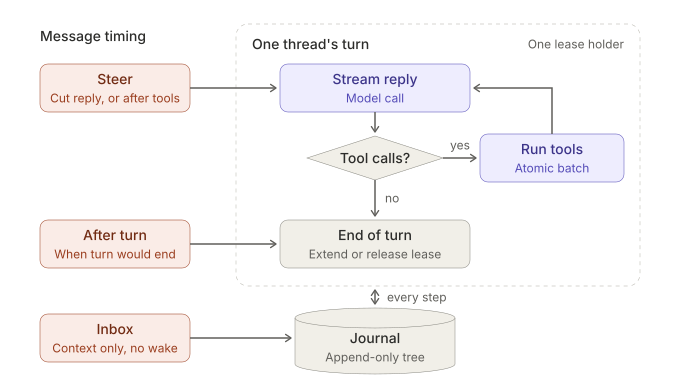
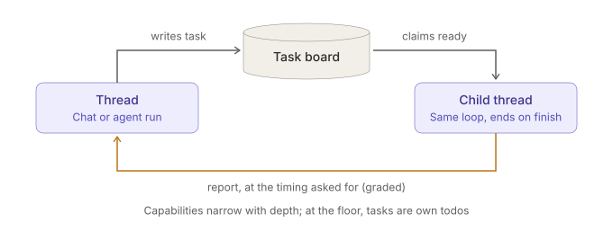

# The loop

[Back to index](README.md)

Arity has one runtime mechanism underneath every tier: an append-only **journal** of entries, a stateless **turn loop** that steps a thread forward from that journal, and **recursion** through the [task board](work.md#the-board).

## Threads and the journal

- **One tree of entries.** Every message, model reply, tool result and report is an immutable entry pointing at its parent. Nothing in the journal is rewritten.
- **A thread is a head pointer.** A conversation is a name pointing at its latest entry, optionally attached to a [task](database.md#tasks). A plain chat, the secretary, a project agent and a subagent's run are all threads.
- **Crash-safe steps.** Each step of a turn is chosen purely by reading the chain back from the thread's head. A tool's side-effects and the journal entry recording its output commit in one write transaction, so resuming after a crash never drops or repeats an action.
- **Fork without copying.** [Forking](work.md#fresh-or-fork) creates a new thread name pointing at an older entry. Both branches share history up to that point.
- **One runner per thread.** An active turn holds a heartbeat lease on its thread, renewed while it streams. Two processes never drive the same thread at once, and a dead process's lease lapses within seconds so the next runner can take over from the journal.

## One turn and its three timings

A turn steps forward from the journal:

1. **Stream reply.** Call the model on the chain so far and publish partial text as it arrives.
2. **Run tools.** If the reply called tools, execute all of them as an atomic batch and call the model again.
3. **End of turn.** A chat ends once the model answers with no tool calls, unless an **after turn** message is waiting to extend it. An agent's run ends only when it calls `finish` with its report (`done`, `blocked` or `needs review`); answering without `finish` pauses to wait if sub-tasks are still out, or reminds the run that nothing has been handed in. When a turn ends after integrating one or more returning child reports, the harness runs the post-use [grading hook](blind-testing.md#grading) on the parent before releasing the lease.

Everything delivered to a thread—user messages, agent messages and returning reports—goes through one door with one of three [timings](agent-tiers.md#message):

| Timing | Boundary | Effect on the loop |
|---|---|---|
| **Steer** | Stream / step | Cuts off a reply in flight (keeping its text so far, dropping half-made tool calls) and joins before the next model call; running tool calls are never cut, so during them it joins once they have their results |
| **After turn** | Turn | Waits until the turn would otherwise end, then answers it instead of releasing the lease |
| **Inbox** | Context / idle | Joins between replies as silent context asking for no answer, so it never keeps a turn going and never wakes an idle or cold thread |

Stopping a turn outright uses the same stream cut-off as **steer**, keeping the partial reply and releasing the lease without adding a message. While a turn holds the lease, incoming deliveries wait in a queue and only the lease holder commits entries to the thread's head.

## Recursion

Delegation is the same loop calling itself one level down through the [board](work.md#the-board):

1. **Call.** A thread writes a task for an agent to the board—the same tool whether the caller is a chat or an agent's run—and says whether the result should return **after turn** or as a **steer**.
2. **Claim and instantiate.** When the task has no open blockers, a dispatcher claims it under a lease, [instantiates](instantiate.md) a child thread with the task's brief as its opening entry, and runs the same turn loop on it. Meanwhile the parent may keep working, or pause waiting (holding no lease) until woken by a **steer** or once all its sub-tasks have reported.
3. **Return.** When the child calls `finish`, its report comes back to the parent thread—chat or worker run alike—at the timing requested, waking an idle or waiting parent once its sub-tasks settle (or immediately on **steer**). After the parent integrates the result in its turn, the post-use grading hook rates the child run.

Capabilities narrow with depth so recursion stays safe and terminates:

- **Clearance propagates down.** Tasks filed by a `private` run stay `private`, whatever the run asks for.
- **The folder propagates down.** A folder attached to a chat passes to the tasks filed there and to their sub-tasks, unless the user gives a task its own. The file tools read only inside it, through symlinks and `..` too, and change nothing. A model cannot choose or change a task's folder.
- **The floor is the base case.** At maximum depth, delegation is removed from the toolset, so a run at the floor does its work directly and calls `finish`.
