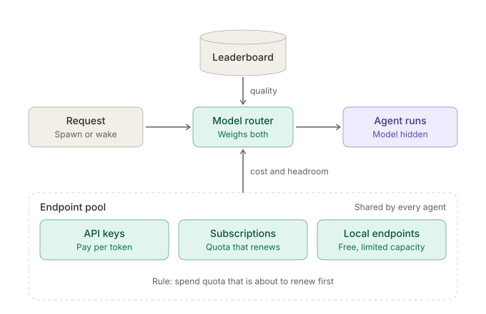

# Model router

[Back to index](README.md)

## What it does

The model router decides which model runs an agent, and which answers a chat. It is the "Pick variant" step of [Instantiate](instantiate.md), so it runs when an agent is created or a cold agent is woken. A live agent never goes through it.

The choice is **blind**: neither the user nor the parent agent is told which model they are working with. That keeps grades honest, because a grader cannot favour a model by name.

## Choosing for a chat

A chat is not a blind run, so the user sees which model answered. Instead of a list of models they make one choice of four: **smart** (the best model they can reach), **fast** (the quickest), **free** (local models and subscriptions with quota left, never a pay-per-token key) or **private** (local models only). The router picks among the models they can reach now, from the leaderboard. A chat keeps its model once its first message is sent; a new choice picks again from the next message. Naming a model directly stays possible, for testing a particular one.

## Leaderboard

Per model, a quality figure and speeds (time to first token, output tokens per second), from two sources kept apart: public benchmarks and published speeds, and Arity's own ratings and measured speeds. Public figures are where a model starts; Arity's own take over as they accumulate. A model nothing is known about ranks last.

## How it chooses

1. **Rule out what is not allowed.** A task's clearance can restrict it to local models. See [Access](access.md#clearance).
2. **Balance two things for what remains:**
   - **The right intelligence for the task**, from scores.
   - **Spending tokens wisely**, from the endpoint pool.

The weight between the two moves with supply. When a subscription's quota is about to reset, its remaining tokens are nearly free, so cost counts for more in that moment. That shifts which model is picked. It does not change any score.

The router also spends some picks on options it is unsure about, to keep learning. See [Blind testing](blind-testing.md).

## Scores

A score is an average over a variant's trials, or a better statistical estimate of the same thing. Getting more runs does not raise a score; it only makes the estimate more certain.

Scores are kept in the [database](database.md), on model pages. The baseline diagram calls this part the leaderboard.

What goes into a score:

**Outcome**

- The rating from whoever received the work.
- Gates: tests pass, CI is green, a QA bot or the user approved. These are verifiable and count for more than a rating.
- Whether the result was used, or the task had to be redone.
- Rework found later, such as a project agent discovering that earlier work broke something.

**Process**

- How often the agent had to be steered.
- Failed tool calls.
- Papercuts filed during the run.

**Efficiency**

- End-to-end time, tokens and cost, number of turns.

Scores are kept separately per tier, role and kind of task, since a model that is good at quick edits may be poor at running a project. Each score records which model did the grading, because models tend to favour output from their own family, and which loadout the agent had, so a good model is not blamed for a bad tool.

## Endpoint pool

One shared pool of every way to reach a model, used by all agents. It belongs to one person and spans their computers; [sharing it](open-questions.md#sharing-with-other-people) is set aside.

| Kind | Cost | Limit |
|---|---|---|
| API keys | Pay per token | Budget |
| Subscriptions | Flat fee, quota that renews | Quota per period |
| Local endpoints | Free | Available only while a GPU on the user's network of computers is free |

**Spend quota that is about to renew first.** Unused subscription quota is lost at the reset. Local endpoints are free but limited. API keys are the overflow.

Agents never see the pool's keys. The router uses them.
