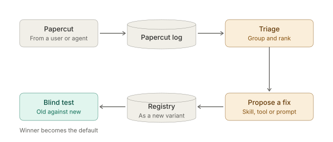

# Papercuts

[Back to index](README.md)

A papercut is a quick note that something got in the way. Any agent or the user can file one at any moment, in a single step, without stopping work. Papercuts are how the system finds out what to improve about itself.

## Two kinds

| Kind | Example | What happens |
|---|---|---|
| Complaint | "This tool's error message didn't say what went wrong." "The skill told me to use a command that doesn't exist." "The brief didn't say which repo." | Logged. Nobody has to respond. |
| Request for help | "I don't have access to the staging server." "I'm stuck and don't know who to ask." | Logged, and also sent as a [message](agent-tiers.md#message) to the parent or the user, delivered by steer or inbox like any other. |

So asking for help is not a new mechanism. It is a message that also leaves a record.

## What a papercut records

The filer writes one line. Everything else is attached automatically:

- Who filed it, and their tier and role.
- The task they were on.
- The skill, tool or MCP server involved, if any.
- The trial record for the run, so the papercut is tied to a variant without the filer knowing which.

## How a papercut differs from a rating

| | Rating | Papercut |
|---|---|---|
| About | The other party in an exchange | The system: tools, skills, prompts, access, the environment |
| Form | A number from 1 to 5 | A line of text |
| When | When asked, after an exchange | Whenever something goes wrong |

See [Blind testing](blind-testing.md#grading) for ratings.

## The improvement loop

1. **File.** A papercut goes into the papercut log, which is part of the [database](database.md): each papercut is attached to its agent run and task.
2. **Triage.** Papercuts are grouped, so that forty agents hitting the same confusing error become one problem with a count, and ranked.
3. **Propose a fix.** A change to a skill, a tool, an MCP server's configuration, or a role's system prompt.
4. **Enter the registry as a new variant.** The fix does not replace the current version. It sits beside it.
5. **Blind test.** The router trials the new variant against the old one, as described in [Blind testing](blind-testing.md).
6. **Keep the winner.** If the new variant scores better and draws fewer papercuts, it becomes the role's default. If not, it is dropped.

The important property is step 4: a fix is never simply applied. It has to win a blind test, the same as any other variant. That keeps a confident but wrong fix from making things worse.

## Design notes

- **Filing must be nearly free.** If it costs an agent much time or context, agents will stop filing.
- **Counts matter more than any one papercut.** A single complaint is an anecdote; the same complaint from many runs is a finding.
- **Papercuts are also a score.** How many papercuts a variant draws is a signal for the [leaderboard](model-router.md#leaderboard).

## Not settled

See [Open questions](open-questions.md#papercuts).
