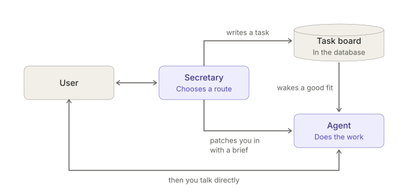
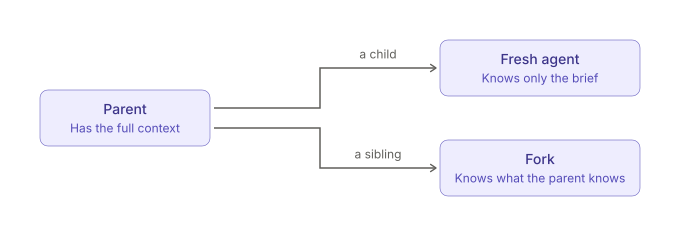

# How work starts

[Back to index](README.md)

Work reaches an agent by one of two routes. The secretary chooses between them.

## Two routes

| Route | What the secretary does | When it suits |
|---|---|---|
| The board | Writes a task to the task board. An agent that fits picks it up | Work that can be described and left to run |
| A patch-in | Connects the user directly to an agent, with a brief already filled in from the conversation with the secretary | Work the user wants to steer |

After either route the user can talk to the agent directly. That is the user's direct line in the [baseline](README.md).

## The board

The board is the set of tasks in the [database](database.md). The user, the secretary and project agents can all write to it.

**A task belongs to whoever asked for it.** When a model files a task for a person it is talking with, the task is that person's: the result comes back to them, and they rate it. An agent that hands work on of its own accord is the asker of that task.

**An entry on the board is what wakes an agent.** When a task becomes ready, an agent that is a good fit for it is woken, or created if none exists. How fit is judged is [undecided](open-questions.md#judging-a-good-fit). Agents are pulled in by available work.

A task entry carries what [instantiation](instantiate.md) needs: what kind of agent it wants, what it requires, and its clearance.

## A patch-in

The secretary introduces the user to an agent and writes the brief, based on the conversation they were just having. The user does not have to repeat anything to the new agent.

## Fresh or fork

When an agent is created for a piece of work, there is a second choice: how much it starts out knowing.

| | Starts with | Relationship | Good for |
|---|---|---|---|
| Fresh | Only the brief | A child | An unbiased second look; narrow tasks; anything where the parent's assumptions should not carry over |
| Fork | Everything the parent knows | A sibling | Work that depends on the conversation so far; exploring one option without losing the thread |

The choice is about how naive the agent should be. It is not about cost, because a fork reads the parent's context from cache.
