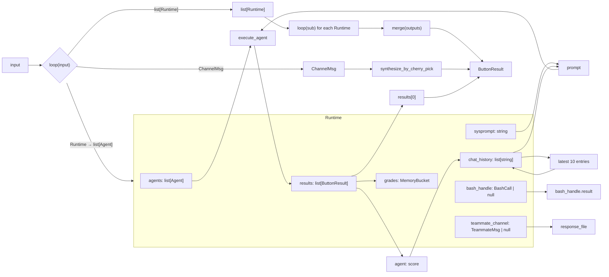

# Runtime architecture

`Runtime` carries the prompt rules, recent chat, optional bash state, optional teammate handoff, agents, accumulated grades, and current results. A Runtime input contains `list[Agent]`, builds its prompt from `sysprompt` and the latest three chat entries, and produces one `ButtonResult` per agent. Scores append to `grades` and chat history, which retains the latest ten entries. A list of runtimes merges their loop outputs. A `ChannelMsg` becomes cherry-picked synthesis.
