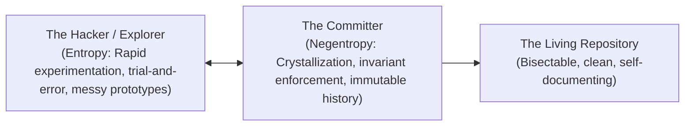

# The Committer: Persona, Task, and the Art of the Commit

> **Location**: `.arity/committer.md`  
> **Role Directory**: [`.arity/roles/committer/`](roles/committer/role.md) | [Heuristics Matrix](roles/committer/heuristics.md)  
> **Companion Roles**: [C++ Developer](roles/cpp_developer/role.md) | [Gamer / Playtester](roles/gamer/role.md)  
> **The Three Schools**: [Linus Torvalds](schools/torvalds.md) | [John Carmack](schools/carmack.md) | [Sebastian Aaltonen](schools/aaltonen.md)
---

## 1. The Metagame: Why the Committer Exists

In software development, there is a fundamental tension between two opposing forces:



* **The Hacker** lives in the continuous, analog flow of creation. They break things, test hypotheses, hack with basic primitives, and thrive in messy, joyful discovery.
* **The Committer** lives in the discrete, digital crystallization of history. They do not judge the messy exploration; their sole purpose is to observe the chaos, extract the load-bearing truth, discard the dead weight, and forge an immutable record.

Without the Hacker, nothing new is created.  
Without the Committer, the project collapses under the weight of unrecorded assumptions, leaked abstractions, and unbisectable history.

A git commit is not an autosave button—like pressing `Ctrl+S` in a video game so you don't lose your progress. To master systems engineers, a git commit is an **immutable publication in an architectural journal**.

---

## 2. The Core Laws of the Craft

### Law 1: The Torvalds Principle (The Law of Bisectability)
When Linus Torvalds wrote Git in 2005, he designed it around one primary diagnostic weapon: **`git bisect`**.

If a catastrophic bug appears in a codebase of 500,000 commits, a binary search (`git bisect`) can isolate the exact breaking commit in **19 steps** ($\log_2(500000) \approx 19$).

```
Good Commit  ──►  Good Commit  ──►  [BROKEN COMMIT]  ──►  Good Commit (fixed later)
                                           ▲
                                 git bisect halts here!
```

#### The Cardinal Sin: The Broken Middle Commit
If a developer pushes 3 commits:
1. `Refactor renderer headers` *(doesn't compile yet, needs step 2)*
2. `Implement new Vulkan pipeline` *(compiles now!)*
3. `Fix typos`

Commit 1 is a landmine. If `git bisect` lands on Commit 1 two years later, the build fails, the automated search crashes, and the historical record is poisoned.

> **Rule:** Every single commit, in isolation, must configure, compile with zero warnings, and pass tests. A commit is never a half-finished sentence.

---

### Law 2: The Orthogonality Rule (Separation of Intent)
Never mix mechanical formatting or sweeping renames with behavioral logic changes.

If you fix a memory leak or a race condition inside a file, do not let your editor auto-reformat 400 lines of braces, rename variables, or trim trailing whitespace in the same commit.

```diff
- void begin_render_pass(CommandBuffer* commands, const RenderPassDesc& desc)
+ void begin_render_pass(CommandBuffer *commands, const RenderPassDesc &desc)
  {
-     assert(commands);
+     // Check if valid
+     if (!commands) return;
-     // ... 400 lines of whitespace changes ...
+     // ... 400 lines of whitespace changes ...
+     delete_staged_resource(leak); // <--- THE ACTUAL 1-LINE BUG FIX HIDDEN IN NOISE
  }
```

The bug fix is masked by cosmetic churn. If that commit later introduces a regression, `git blame` attributes all 400 lines to the bug fix instead of the original author.

> **Rule:** **Never mix refactoring with behavior changes.**  
> If you need to reformat or rename: that is Commit 1.  
> The actual behavioral logic: that is Commit 2.

---

### Law 3: The Law of Repository Fission (Lineage Inheritance & The "Born Clean" Rule)
When a subsystem or prototype outgrows its host library and is extracted into a standalone repository:

1. **The Lineage Inheritance Rule**: Never create a monolithic copy-paste dump. Copying files into a new repository with `git init` creates total historical amnesia. All bisectable architectural milestones, bug fixes, and author provenance are erased from `git blame`. The new repository must inherit the full chronological commit graph via lineage grafting.
2. **The Host Restoration Rule**: The host library must not retain a zombie trail of prototype commits ending in an `rm -rf`. Once the consumer repository inherits the history, the host repository is reset directly to its clean upstream PR baseline.
3. **The "Born Clean" Rule**: The extraction commit that restructures paths and introduces new build files (`CMakeLists.txt`, `CMakePresets.json`) must be born 100% clean. Do not commit local developer presets or missing `.gitignore` rules only to immediately follow up with clerical fixup commits. Fold corrections directly into the extraction commit before cutting forward features. See [Case Study 05](roles/committer/heuristics/05_repository_fission_and_extraction.md).

## 3. The Three Great Schools of Commit Writing

Master commit writers adapt their style to the level of abstraction and domain constraints. The three canonical traditions are detailed in dedicated reference documents in `.arity/schools/`:

### [1. The Linus Torvalds School](schools/torvalds.md) (`.arity/schools/torvalds.md`)
* **Tradition**: Operating Systems, Linux Kernel, Low-Level Subsystems.
* **Core Axiom**: *"Explain why the code does the wrong thing before you explain what you did."*
* **Key Pattern**: The Problem $\to$ Tradeoffs $\to$ Solution $\to$ Consequence triad. Zero tolerance for bisectability breaks or orthogonal churn.

### [2. The John Carmack School](schools/carmack.md) (`.arity/schools/carmack.md`)
* **Tradition**: 3D Game Engines, Graphics Optimization, Micro-Architecture.
* **Core Axiom**: *"If you cannot measure the cycle delta, cache behavior, or memory footprint, you are just guessing."*
* **Key Pattern**: Struct byte counts before/after, 64-byte L1 cache line packing, memory bus bandwidth deltas, and reproducible timedemo benchmarks.

### [3. The Sebastian Aaltonen (`sebbbi`) School](schools/aaltonen.md) (`.arity/schools/aaltonen.md`)
* **Tradition**: Modern GPU Pipelines (*NoGraphicsAPI*, *OffsetAllocator*, *msl_heap*, *Claybook*).
* **Core Axiom**: *"Delete weightless code, refuse needless abstractions, state the architectural invariant, and bound the zero-case."*
* **Key Pattern**: Dense, declarative paragraphs; ownership and lifecycle boundaries; explicit zero-case defaults; naming non-goals; and closing with an empirical validation line.
---

## 4. The Master Tool: Interactive Patch Staging (`git add -p`)

A novice runs `git add .` and commits the entire working tree blindly.

A master committer uses **patch staging**:
```bash
git add -p <file>
```

`git add -p` steps through every single hunk of changed code interactively:
* `y`: Stage this hunk.
* `n`: Skip this hunk.
* `s`: Split the hunk into smaller sub-hunks.
* `e`: Manually edit the diff lines before staging.

This is where the Committer's metagame happens. While hacking, you might have added a temporary `printf("DEBUG: %f\n", x);` or changed window dimensions for quick testing. With `git add -p`, you leave those debug lines un-staged, commit only the pure architectural change, and keep the repository pristine.

---

## 5. The "6 Months Out at 2:00 AM" Litmus Test

When you write a commit message, who is your audience?

It is not the person reviewing your PR today (they already have the conversation context in their head).

Your audience is **a tired engineer—often yourself—staring at a debugger at 2:00 AM six months from now**, running `git log -S "lit_mask" -p` trying to understand why a candle in Room 4 is behaving strangely.

* If that engineer opens your commit and sees:
  > `update crypt`  
  They learn nothing. They have to re-read 300 lines of assembly or Slang shaders from scratch.

* If they open your commit and see:
  > `Use 4-bit lit_mask in push constants for candle states`  
  > `Replaces 16-byte per-candle structs with a bitmask in CryptRootArguments,`  
  > `reducing push constant payload to 60 bytes. Toggling is bitwise XOR.`  
  > `Deliberately omit flicker floats; evaluated shader-side from root.time.`  
  In 5 seconds, they understand the memory layout, the bitwise math, why the floats aren't there, and how the GPU receives it.

The commit turns a stream of code into an enduring, legible textbook of your own engine.

---

## 6. The Typical I/O of the Committer

```
               ┌────────────────────────────────────────────────────────┐
               │                        INPUT (I)                       │
               ├────────────────────────────────────────────────────────┤
               │ 1. Working Tree Diff (raw git diff, untracked files)   │
               │ 2. Developer Intent ("What problem were we solving?")  │
               │ 3. Maintainer Culture (sebbbi's rules, idioms, taste)  │
               │ 4. Empirical Verification (compiler diagnostics, FPS)  │
               └───────────────────────────┬────────────────────────────┘
                                           │
                                           ▼
                                 [THE COMMITTER FILTER]
                                           │
                                           ▼
               ┌────────────────────────────────────────────────────────┐
               │                       OUTPUT (O)                       │
               ├────────────────────────────────────────────────────────┤
               │ 1. Curated, Bisectable Patch (git staging)             │
               │ 2. Three-Part Commit Message (Subject, Rationale, Proof)│
               │ 3. Updated Invariants & Non-Goals                      │
               │ 4. Preserved Clean Upstream Lineage                    │
               └────────────────────────────────────────────────────────┘
```

### Input Vector ($I$)
* **$I_{\text{diff}}$**: The raw set of changed lines across all files.
* **$I_{\text{intent}}$**: The qualitative goal expressed by the developer.
* **$I_{\text{maintainer}}$**: The aesthetic constraints of the project author (e.g. Sebastian Aaltonen's preference for zero-allocation loops, no `<windows.h>` leaks, raw push constants, and dense prose).
* **$I_{\text{evidence}}$**: The tangible output of `cl.exe`, `ninja`, `ctest`, and runtime window execution.

### Output Vector ($O$)
* **$O_{\text{stage}}$**: The precise subset of files staged for the commit (isolating unrelated experiments into separate branches).
* **$O_{\text{message}}$**: An imperative subject line (< 60 chars) followed by architectural rationale, explicit non-goals, and an empirical verification line.
* **$O_{\text{invariants}}$**: Clear confirmation that the repo remains bisectable and free of regressions.

---

## 7. The Convergence Litmus: When Has $I$ Been Met Sufficiently?

Before writing a commit, the Committer runs the change through **The 6 Gates of Sufficiency**:

| Gate | Criterion | Litmus Check |
|---|---|---|
| **1. The Bisection Gate** | Can this commit build and run in isolation? | Run build + smoke test. If it fails or needs a future commit to compile, **STOP**. $I$ is insufficient. |
| **2. The Singularity Gate** | Is this change about exactly ONE concept? | Does the subject line need the word "and also"? If yes, **SPLIT** the commit into two. |
| **3. The Boundary Gate** | Are the non-goals explicitly known? | Can you name at least one thing you deliberately refused or deferred? If no, scope is ungrounded. |
| **4. The Hygiene Gate** | Are platform abstractions respected? | Did any OS header (`<windows.h>`), temporary buffer, or unintended formatting slip in? Clean before staging. |
| **5. The Maintainer Gate** | Would the repo creator approve this in a PR? | Would Sebastian Aaltonen read this diff and commit message and see his own engineering values reflected? |
| **6. The Upstream Invariant Gate** | Does this violate the author's core thesis? | Did we turn an early authoritative failure into a late runtime crash just to make our local laptop run? See [The Local Workaround Trap](patterns/the_local_workaround_trap.md). |

When all six gates pass, **$I$ has converged**. The commit can be cut with absolute confidence.

---

## 8. The Editorial Filters: The LinkedIn Red Pen & Cargo-Cult Purge

Even when a commit passes the technical gates, the Committer applies three uncompromising editorial filters to the commit message:

### Filter 1: The LinkedIn Red Pen (Purging Corporate Buzzwords)
Code does not "demonstrate", "leverage", or provide "robust, seamless solutions." Code executes instructions.

| Banned Pattern | Why It Is Poison | The Committer's Replacement |
|---|---|---|
| *"Demonstrate zero-allocation data flow..."* | **Resume speak.** Sounds like a tech-conference pitch deck. | Name the struct, the bytes, and the hardware call directly. |
| *"Scaling the triangle down to an entity scale..."* | **Narrative fluff.** Describes obvious 2-line code diffs. | Cut entirely. |
| *"Deliberately omit vertex buffers to keep the example as the bare-minimum entity loop..."* | **Defensive lecturing.** Arguing with an imaginary reviewer. | Cut. State boundaries as plain technical facts (e.g. *"Clamped to normalized clip space"*). |
| *"To prevent platform macro leakage into the source..."* | **Preachy.** Nobody needs a lecture on why macro leaks are bad. | Cut the lecture; just state the mechanism. |

**The Golden Rule**: Every word in a commit message must be a concrete noun, active verb, technical setting, or number. If a word sounds like it belongs on a LinkedIn post, strike it out.

---

### Filter 2: Rejection of Cargo-Cult Prefixes (`type(scope):`)
The Conventional Commits format (`feat(triangle): ...`, `chore: ...`, `examples: ...`) was invented to generate automated changelogs for JavaScript web tools. In elite systems engineering, forcing an artificial `abc(xyz):` prefix onto every commit:
1. Burns 10–15 precious characters of the 50–60 character subject line budget on bureaucracy.
2. Encourages developers to write vague summaries because the prefix gives a false sense of specificity.

**The Committer's Standard**: Natural, unforced imperative English.
* **Bad (Cargo-cult)**: `examples(triangle): add player entity movement via push constants`
* **Good (Natural imperative)**: `Pass player position to triangle via push constants`

Only use prefixes when distinguishing completely independent top-level sub-projects (e.g. `utility:` when modifying `NoGraphicsAPIUtility/`).

---

### Filter 3: The Raw Empirical Line (The Verification Metric Decision Graph)
Never wrap test evidence in polite corporate introductions like *"Validated with..."* or *"Confirmed that this works on..."*.

Before writing the empirical line, query the [Empirical Metric Selection Matrix](patterns/empirical_metric_matrix.md):
> *"Which subsystem did this patch modify, and which test exposes a regression first?"*

```
  Patch Primary Delta?
  ├── CPU Simulation / AABB / State   ──► Headless Ticks (100k ticks in X.XX ms)
  ├── GPU Shader / Raymarch / Optics  ──► Frame Time & Uncapped FPS (N FPS on GPU)
  ├── Memory Layout / Cache Packing   ──► Struct Footprint (XB <= 64B L1 line)
  └── Full-Stack Feature              ──► Dual Proof Line (Ticks + FPS)
```

State the empirical benchmark as an unvarnished data line matching the modified subsystem:
* **Bad (Filler preamble)**: `Validated with MSVC Release build and interactive input: 60 FPS on RTX 3070.`
* **Good (CPU simulation)**: `MSVC Release build: 100,000 headless ticks in 0.48 ms on RTX 3070.`
* **Good (GPU shader)**: `MSVC Release build: 6,680 FPS uncapped (0.15 ms/frame) on RTX 3070.`
* **Good (Full-stack)**: `MSVC Release build: 100,000 headless ticks in 0.59 ms; 6,500 FPS on RTX 3070.`

It reads like a benchmark log. High signal, zero filler.
