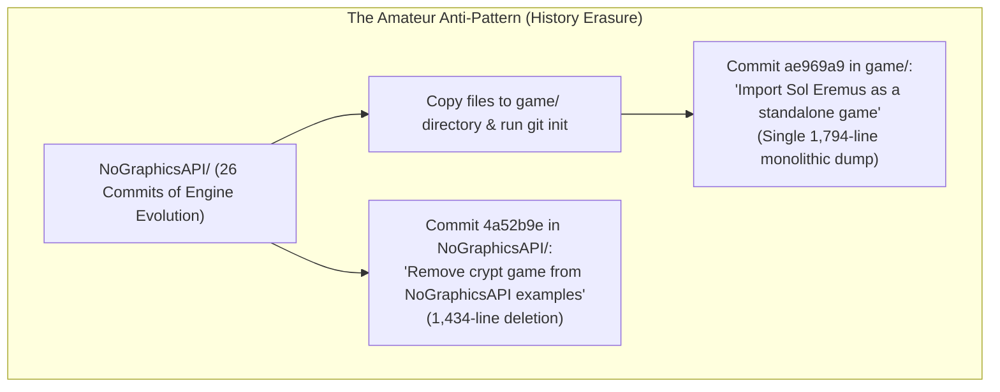
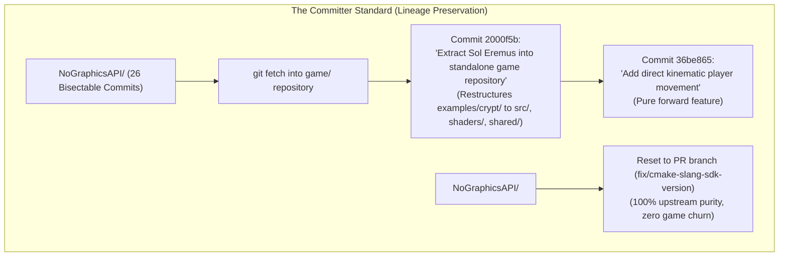

# Case Study 05: Repository Fission & Lineage Grafting

> **Location**: `.arity/roles/committer/heuristics/05_repository_fission_and_extraction.md`  
> **Topic**: Prototype extraction, lineage preservation, and the "Born Clean" rule  
> **Evolution**: Grade D $\to$ Grade S  

---

## 1. Initial State (The Amateur Anti-Pattern)

When a game prototype living inside a graphics library's example directory (`NoGraphicsAPI/examples/crypt/`) outgrows its host and needs to become a standalone repository (`game/`), developers instinctively execute **The Monolithic Fork Split**:



### Why This Is Grade D Systems Engineering
1. **Total Historical Amnesia**: `game/` starts with a 1,794-line dump. All 26 bisectable commits—where the mesh shader was born, where the bump allocator offset race was debugged, where the Inigo Quilez soft shadow was derived—are permanently erased from `git blame`.
2. **Ghost Town in Upstream**: `NoGraphicsAPI/` retains 26 dead commits developing a game inside its examples directory, only for commit 27 to wipe the entire directory. It pollutes the graphics library's history with dead churn.
3. **Clerical Commit Sprawl**: The hasty import introduces local developer presets (`lsp`) and missing `.gitignore` entries, prompting messy follow-up commits like *"Ignore CMakeUserPresets.json"* and *"Remove local lsp preset"*.

---

## 2. The Committer Standard: Lineage Grafting

Instead of a copy-paste import, the Committer executes **Repository Fission with Lineage Grafting**:



### Three Inviolable Laws of Repository Fission

#### Law 1: The Lineage Inheritance Rule
A standalone consumer repository must inherit the full chronological Git commit graph from the prototype phase. The new repository's `git log` must retain every commit that defined its shaders, pipelines, and data layouts.

#### Law 2: The Host Restoration Rule
The host library (`NoGraphicsAPI`) must not retain a zombie trail of prototype commits ending in an `rm -rf`. Once the consumer repository inherits the history, the host repository's branch is reset directly to its pristine upstream PR baseline (`19971ce`).

#### Law 3: The "Born Clean" Rule (No Clerical Fixups)
When authoring the extraction commit (`Extract Sol Eremus into standalone game repository`):
- Do not commit local developer presets (`lsp`) that collide with `CMakeUserPresets.json`.
- Do not commit without ignoring machine-local files.
- The extraction commit must be **born 100% clean**. If a configuration oversight occurs, use a soft reset (`git reset --soft`) to fold the correction directly into the extraction commit before cutting forward features.

---

## 3. The Resulting Artifacts

### The Clean Extraction Commit (`2000f5b`)
```git
Extract Sol Eremus into standalone game repository

Restructure in-tree crypt example into standalone Windows C++20 game
layout (src/, shared/, shaders/). Introduce root CMakeLists.txt and
presets consuming sibling NoGraphicsAPI without building its examples
or tests. Remove in-tree graphics API sources from the game repository.

MSVC Release build: 100,000 headless ticks in 0.37 ms, windowed run verified.
```

### The Clean Feature Tip (`36be865`)
```git
Add direct kinematic player movement

Route an Input snapshot struct into GameWorld::step(). Normalize diagonal
movement and apply 0.45 crouch, 1.0 walk, and 1.65 sprint speeds. Drive
scalar player_z and vertical velocity via edge-triggered jump input under
4.5 gravity. Reshape player quad geometry based on grounded crouch and
vertical jump height while preserving room collision and candle toggles.

MSVC Release build: 100,000 headless ticks in 0.75 ms, windowed run verified.
```
