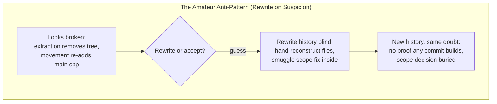
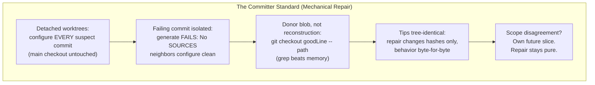

# Case Study 06: History Repair Without Scope Creep

> **Location**: `.arity/roles/committer/heuristics/06_history_repair_without_scope_creep.md`
> **Topic**: Proving history breakage mechanically, then repairing it behavior-identically
> **Evolution**: Grade D $\to$ Grade S

---

## 1. Initial State (The Amateur Anti-Pattern)

A rewritten extraction drops one game-owned file. The follow-up commit silently
re-adds it whole — plus an unrelated scope change nobody approved. The result
*looks* like three clean commits and builds fine at tip, so nobody notices that
the middle of history cannot build:



### Why This Is Grade D Systems Engineering

1. **Suspicion is not evidence**: `git show` suggested the extraction was
   unbuildable, but no commit had ever been configured in isolation. Rewriting
   on a reading — however careful — risks destroying good history to fix a
   misdiagnosed problem.
2. **Reconstruction is fabrication**: hand-writing the "missing" file produces
   content that never existed anywhere, breaking the lineage graft that Case
   Study 05 worked to preserve.
3. **Scope smuggling**: the rewrite's movement commit also dropped jump
   handling. Folding that decision into a repair commit would mix *restore the
   past* with *change the game* — a Singularity Gate violation.

---

## 2. The Committer Standard: Prove, Donor, Defer



### Three Inviolable Laws of History Repair

#### Law 1: The Worktree Proof Rule

Never rewrite history on suspicion. Before choosing rewrite-vs-skip, configure
(then build, then smoke-test) every commit in the suspect range inside **detached
worktrees** — never `checkout`/`stash` the working tree to do it. The proof must
name the exact failing commit and its exact error (`Cannot find source file`,
not "looks wrong"). Neighbors must pass the same proof, or the range is wider
than believed.

#### Law 2: The Donor-Blob Rule (Repairs Are Behavior-Preserving)

A repair copies exact blobs from the superseded line; it never authors content.
`git checkout <good-commit> -- <path>` plus `commit-tree` replumbing keeps tips
**tree-identical** (`git diff --quiet oldTip newTip` must pass), so the build,
the binary, and the LSP database are provably unaffected. Verify the donor
before claiming what was lost — in the instance below, `grep` showed the
baseline never contained jump at all; the "stripping" happened in the movement
commit, and no fabrication was needed anywhere.

#### Law 3: The Scope-Deferral Rule

Where donor line and rewrite disagree on *behavior*, the repair keeps current
behavior and the disagreement becomes its own future slice. The repaired
movement delta touched `src/main.cpp` only (+45/−13, zero unrelated lines);
jump stayed cleanly absent for a later slice to add-or-drop explicitly. Restore
the past in the repair; change the game in a commit with its own problem
statement.

### Standing Procedure

1. Proof worktrees → failing commit + error on record.
2. Backup ref (`main-before-repair`) before any ref move.
3. Rebuild chain with plumbing (`read-tree`/`commit-tree`), preserving
   author, dates, messages.
4. Re-prove **every** rewritten commit (configure + build + smoke), not just
   the touched one; confirm tip trees identical.
5. Confirm side state unchanged (stash applicability behavior-identical
   pre/post).
6. Delete all scaffolding worktrees; working tree clean.

---

## 3. The Resulting Artifacts (Instance: Sol Eremus, 2026-09-11)

```text
* 33bc7e2 Generate the clangd compilation database from a Ninja preset (tree == old tip)
* f4c130f Add direct kinematic player movement (45+/13− delta, was 820-line add)
* 30e7302 Extract Sol Eremus into standalone game repository (+ donor src/main.cpp)
```

Per-commit proof (VS generator, Release, `--headless` 100k ticks):
`30e7302` 0.36 ms · `f4c130f` 0.42 ms (matches the commit message's own claim
exactly) · `33bc7e2` 0.43 ms — all `[Lit, Lit, Off]`. Full session record:
`.arity/committer/github_mastermind.jsonl`.
